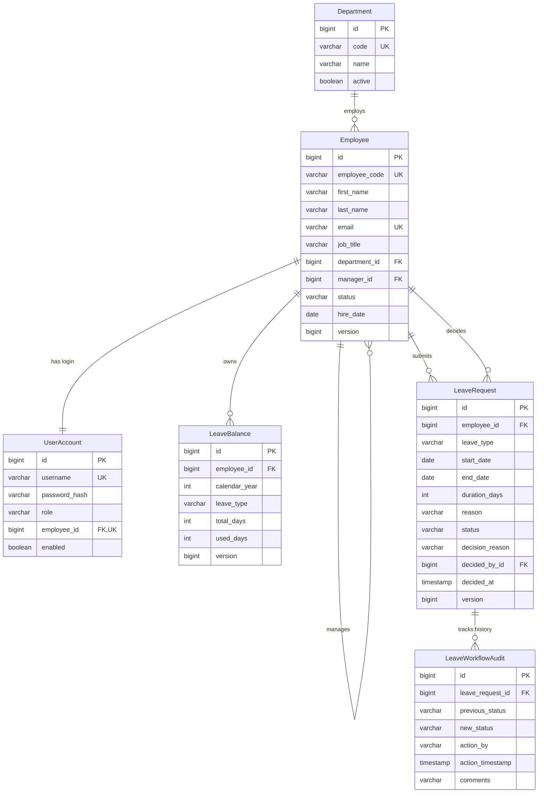
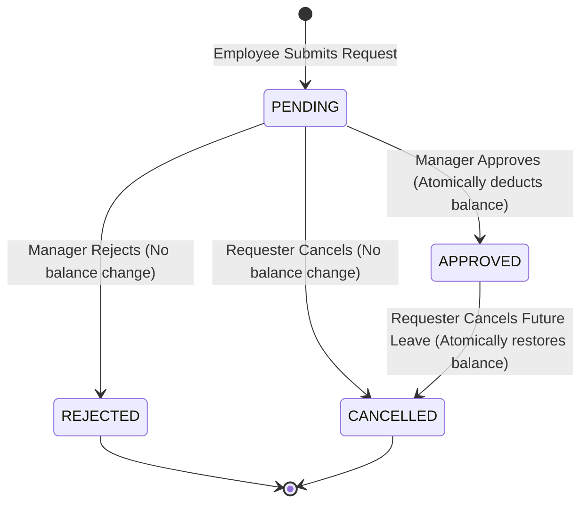

# Employee Management & Leave Workflow Platform

A production-style, monolithic backend application built with **Java 21**, **Spring Boot 3.3.3**, **Spring Security (JWT)**, **Spring Data JPA**, **Flyway**, and **MySQL 8**. 

The system implements real enterprise business workflows, atomic balance adjustments, optimistic concurrency protection, strict role-based access control, and comprehensive automated testing.

---

## 1. System Architecture & Tech Stack

### Core Technology Stack
- **Language**: Java 21 (LTS)
- **Framework**: Spring Boot 3.3.3 (Spring Web, Spring Data JPA, Spring Security, Actuator, Validation)
- **Security**: Stateless JWT Authentication (`io.jsonwebtoken:jjwt 0.12.5`) with BCrypt password hashing
- **Database & Persistence**: MySQL 8.0, Hibernate ORM, Flyway Migrations
- **Testing**: JUnit 5, Mockito, Spring Boot Test, H2 In-Memory Database (test profile), Testcontainers (MySQL)
- **API Documentation**: OpenAPI 3.0 / Swagger UI (`springdoc-openapi 2.6.0`)
- **Containerization**: Multi-stage Dockerfile, Docker Compose
- **Build Tool**: Apache Maven (bundled with portable Maven Wrapper `./mvnw`)

### Architectural Layering
The codebase follows standard enterprise Controller $\to$ Service $\to$ Repository layering:
```
┌────────────────────────────────────────────────────────┐
│      REST Controllers (/api/v1) + Swagger Docs         │  <- DTO Validation (@Valid)
└──────────────────────────┬─────────────────────────────┘
                           │ Request DTOs / Response DTOs
┌──────────────────────────▼─────────────────────────────┐
│                   Service Layer                        │  <- Business Rules, @Transactional,
│  (LeaveWorkflowService, EmployeeService, AuthService)   │     Optimistic Locking, In-Tx Revalidation
└──────────────────────────┬─────────────────────────────┘
                           │ Domain Entities (JPA)
┌──────────────────────────▼─────────────────────────────┐
│                 Repository Layer                       │  <- Spring Data JPA, @EntityGraph,
│  (EmployeeRepository, LeaveRequestRepository, etc.)    │     JOIN FETCH (N+1 query prevention)
└──────────────────────────┬─────────────────────────────┘
                           │ SQL / JDBC
┌──────────────────────────▼─────────────────────────────┐
│       Database (MySQL 8 / Flyway Migrations / H2)      │  <- Constraints, Foreign Keys, Versioning
└────────────────────────────────────────────────────────┘
```

---

## 2. Domain Model & Database Design

### Entity Relationship Diagram (ERD)



### Database Integrity Safeguards
1. **Unique Constraints**:
   - `employees(email)`, `employees(employee_code)`
   - `user_accounts(username)`, `user_accounts(employee_id)`
   - `departments(code)`
   - `leave_balances(employee_id, calendar_year, leave_type)`
2. **Check Constraints**:
   - `leave_balances`: `CHECK (used_days >= 0 AND used_days <= total_days)` prevents negative balances and overdrafts at the database level.
3. **Database Concurrency Versioning**:
   - `employees.version`, `leave_balances.version`, and `leave_requests.version` columns enable JPA `@Version` optimistic concurrency control.

---

## 3. Leave Approval Workflow & Concurrency Strategy

### Workflow State Machine



### Working Day & Holiday Calculation Rules
- **Weekends**: Saturdays and Sundays are excluded from leave duration.
- **Fixed Public Holidays**: Company-wide fixed holidays (e.g. New Year's Day, Labor Day, Christmas) are excluded.
- **Validation**:
  - `startDate <= endDate`
  - `durationDays >= 1` (a leave request submitted solely across weekends/holidays will be rejected with `BusinessRuleException`).

### Concurrency Protection & In-Transaction Revalidation
A frequent failure point in naive leave management systems is the **double-deduction race condition**:
1. Two managers or two rapid clicks attempt to approve the same leave request simultaneously.
2. An employee with 5 days balance submits two separate 5-day leave requests to different managers; both managers approve at the exact same moment.

**How this platform guarantees data integrity**:
- **In-Transaction Balance Revalidation**: When `approveLeaveRequest` executes, it re-queries the current `LeaveBalance` inside the active `@Transactional` boundary, checks `balance.hasSufficientBalance(...)`, and executes `balance.deduct(...)`.
- **Optimistic Locking (`@Version`)**: Both `LeaveRequest` and `LeaveBalance` have a `@Version Long version` attribute.
  - When Thread A commits first, it increments `version` from `0` to `1`.
  - When Thread B tries to commit with its stale snapshot (`version=0`), Hibernate detects the version mismatch and aborts the transaction with `OptimisticLockingFailureException`.
  - The `@RestControllerAdvice` translates this into an HTTP `409 Conflict` response with a clear message: `"The resource was modified concurrently by another request. Please reload and retry."`
  - **Result**: The balance is deducted exactly once, never twice.

---

## 4. Authentication, Authorization & Security Controls

### Role Hierarchy & Permissions
| Role | Permissions & Scopes |
| :--- | :--- |
| `ROLE_EMPLOYEE` | View own profile (`/me`), view own leave requests & balances, submit leaves, cancel own eligible leaves. Cannot view other employees' private data. |
| `ROLE_MANAGER` | All employee permissions + view pending leave requests for **direct reportees only**, approve/reject leaves within their direct reporting tree. |
| `ROLE_ADMIN` | Full organization-wide access: create/update/deactivate departments and employees, view all company leaves, override leave approvals. |

### Security Safeguards
1. **Privilege Escalation Prevention**:
   - The public registration endpoint (`POST /api/v1/auth/register`) strictly assigns `ROLE_EMPLOYEE`. Role assignment is not accepted in public payloads.
   - Only an authenticated `ADMIN` can create accounts with `ROLE_MANAGER` or `ROLE_ADMIN`.
2. **Employee Code Server Generation**:
   - Self-registered employees receive server-generated codes (`EMP-XXXXXX`), preventing ID spoofing.
3. **Manager Scope Verification**:
   - Having `ROLE_MANAGER` does not grant global approval rights. `UserSecurityService.canManageLeaveRequest` verifies that the requester directly reports to the authenticated manager (`employee.manager.id == currentUserId`).
4. **Insecure Direct Object Reference (IDOR) Defense**:
   - Method security `@PreAuthorize("@userSecurityService.canAccessEmployee(#id)")` ensures users cannot inspect or tamper with another employee's records by altering URL parameters.
5. **No Hardcoded Secrets**:
   - JWT signing keys and database credentials are read from environment variables (`JWT_SECRET_KEY`, `DB_URL`, `DB_USERNAME`, `DB_PASSWORD`).

---

## 5. API Reference & Sample Requests

Interactive documentation is available at `http://localhost:8080/swagger-ui.html` when running.

| Method | Endpoint | Access | Description |
| :--- | :--- | :--- | :--- |
| `POST` | `/api/v1/auth/register` | Public | Register new employee (safe default `ROLE_EMPLOYEE`) |
| `POST` | `/api/v1/auth/login` | Public | Login with username & password, returns JWT token |
| `GET` | `/api/v1/employees/me` | Authenticated | View authenticated employee profile |
| `GET` | `/api/v1/employees/{id}` | Self / Manager / Admin | View employee profile (IDOR protected) |
| `GET` | `/api/v1/employees` | Manager / Admin | Search employees with pagination and filters |
| `POST` | `/api/v1/employees` | Admin | Create employee with designated role |
| `PUT` | `/api/v1/employees/{id}` | Admin | Update employee details |
| `DELETE` | `/api/v1/employees/{id}` | Admin | Deactivate employee |
| `GET` | `/api/v1/departments` | Authenticated | List departments (paginated) |
| `POST` | `/api/v1/departments` | Admin | Create department |
| `POST` | `/api/v1/leaves` | Authenticated | Submit leave request |
| `GET` | `/api/v1/leaves/my-requests` | Authenticated | View current employee's leave requests |
| `GET` | `/api/v1/leaves/my-balances` | Authenticated | View current employee's leave balances |
| `GET` | `/api/v1/leaves/manager-queue` | Manager / Admin | View pending requests for manager's team |
| `PUT` | `/api/v1/leaves/{id}/approve` | Direct Manager / Admin | Approve leave request (atomically deducts balance) |
| `PUT` | `/api/v1/leaves/{id}/reject` | Direct Manager / Admin | Reject leave request |
| `PUT` | `/api/v1/leaves/{id}/cancel` | Requester / Admin | Cancel leave request (restores balance if approved) |
| `GET` | `/api/v1/leaves/{id}/audits` | Authenticated | View workflow state audit history |

A complete, runnable test script is provided in [`src/main/resources/api-requests.http`](file:///Users/saatvik.goswami/.gemini/antigravity/scratch/employee-leave-platform/src/main/resources/api-requests.http).

---

## 6. Development Seed Credentials (Development Environment Only)

> [!CAUTION]
> These credentials are generated by `V2__seed_initial_data.sql` for local development and demonstration only. Passwords are hash-encoded using BCrypt.

| Role | Username / Email | Password | Employee Code | Notes |
| :--- | :--- | :--- | :--- | :--- |
| **ADMIN** | `admin@company.com` | `password` | `EMP-001` | System administrator |
| **MANAGER** | `manager.john@company.com` | `password` | `EMP-002` | Engineering manager |
| **EMPLOYEE** | `alice.dev@company.com` | `password` | `EMP-003` | Reports to Manager John |
| **EMPLOYEE** | `bob.dev@company.com` | `password` | `EMP-004` | Reports to Manager John |

---

## 7. How to Build, Run & Test

### Prerequisites
- **Java**: JDK 21 or newer (project tested and verified on Temurin JDK 21 / 25)
- **Maven**: Bundled Maven wrapper (`./mvnw`) is included; no local Maven installation required
- **Docker**: (Optional) For containerized MySQL and full-stack Docker Compose deployment

### 1. Run Automated Tests
```bash
./mvnw clean test
```
The test suite utilizes the fast in-memory H2 database with MySQL compatibility mode (`application-test.yml`). It executes all business rule tests, security tests, and multi-threaded concurrency tests in **< 10 seconds** without requiring Docker.

### 2. Run Locally with Local MySQL
1. Ensure MySQL 8 is running locally.
2. Export environment variables or create `.env`:
   ```bash
   export DB_URL="jdbc:mysql://localhost:3306/employee_leave_db?createDatabaseIfNotExist=true&useSSL=false&allowPublicKeyRetrieval=true&serverTimezone=UTC"
   export DB_USERNAME="root"
   export DB_PASSWORD="rootpassword"
   export JWT_SECRET_KEY="AStrongSecretKeyAtLeast256BitsLongForProductionSecurity12345!"
   ```
3. Run application:
   ```bash
   ./mvnw spring-boot:run
   ```

### 3. Run with Docker Compose
To spin up MySQL 8 and the Spring Boot backend container together:
```bash
docker compose up --build
```
Access Swagger UI at: `http://localhost:8080/swagger-ui.html`

---

## 8. Automated Test Execution Report

The test suite was executed and verified directly against the codebase. All 25 tests passed:

```
[INFO] Running com.company.employeeleave.repository.EmployeeRepositoryIntegrationTest
[INFO] Tests run: 3, Failures: 0, Errors: 0, Skipped: 0
[INFO] Running com.company.employeeleave.security.SecurityAndAuthorizationIntegrationTest
[INFO] Tests run: 8, Failures: 0, Errors: 0, Skipped: 0
[INFO] Running com.company.employeeleave.concurrency.LeaveWorkflowConcurrencyTest
[INFO] Tests run: 1, Failures: 0, Errors: 0, Skipped: 0
[INFO] Running com.company.employeeleave.service.LeaveWorkflowServiceTest
[INFO] Tests run: 8, Failures: 0, Errors: 0, Skipped: 0
[INFO] Running com.company.employeeleave.service.LeaveCalculationServiceTest
[INFO] Tests run: 5, Failures: 0, Errors: 0, Skipped: 0
[INFO] ------------------------------------------------------------------------
[INFO] Tests run: 25, Failures: 0, Errors: 0, Skipped: 0
[INFO] BUILD SUCCESS
```

### Verified Invariants
1. **Concurrency Safety**: Verified via `LeaveWorkflowConcurrencyTest` with 2 threads racing on `CountDownLatch`. Exactly 1 approval succeeded and 1 failed with optimistic lock mismatch. `usedDays` was exactly 6, proving that concurrent approval cannot double-deduct leave balances.
2. **Weekend & Holiday Exclusion**: Verified via `LeaveCalculationServiceTest` that Saturdays, Sundays, and official holidays are excluded from leave duration.
3. **In-Transaction Balance Revalidation**: Verified via `LeaveWorkflowServiceTest` that if a balance decreases prior to approval, approval fails and leaves request in `PENDING` state.
4. **Manager Scope & IDOR Protection**: Verified via `SecurityAndAuthorizationIntegrationTest` that employees cannot access peers' records, and managers cannot decide leaves outside their reporting scope.

---

## 9. Design Trade-Offs & Future Improvements

- **Optimistic Locking vs. Pessimistic Locking**:
  - *Trade-off*: Optimistic locking (`@Version`) was selected because leave approvals are low-contention events under typical operating conditions. It avoids holding database row locks while external systems or threads execute.
  - *Alternative*: If high contention were expected, `SELECT ... FOR UPDATE` (pessimistic write lock) could be applied.
- **Weekend/Holiday Engine**:
  - *Trade-off*: A fixed company holiday registry was implemented to provide deterministic business day calculations.
  - *Future Enhancement*: Integrate with a regional holiday calendar service or database table per country/jurisdiction.
- **Monolith Architecture**:
  - *Trade-off*: Kept as a single, modular monolith rather than microservices, ensuring strong ACID transactions without requiring distributed transaction coordinators (2PC/Saga).
